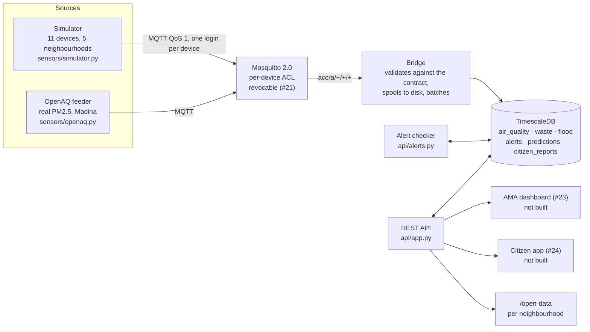

# Final architecture: AgroConnect, HealthConnect, SmartCity Accra

Lab 14 Part C (#47). This document brings together the three systems Group 3 (Highlanders) built in ICS 534 in 2026. For each system it covers the final architecture, what it actually runs on, and what it doesn't do. It ends with the integration design and what we learned.

**State as of 24 Nov 2026.**
- AgroConnect and HealthConnect are finished. Their sections describe what was deployed.
- SmartCity runs on a laptop with Docker but is not yet on AWS (#28, #29, #35).
- The integration design (#46) isn't written yet.

Both gaps are marked where they occur, and this file is updated when they land.

## The three systems at a glance

| | AgroConnect (Prosit 1) | HealthConnect (Prosit 2) | SmartCity Accra (Prosit 3) |
| --- | --- | --- | --- |
| Serves | Extension agents and smallholder farmers in northern Ghana | Community health volunteers, patients, clinicians, pharmacists, GHS officials: 8 roles | AMA officials and Accra residents |
| Hard part | Offline field work, subsidy-window bursts (≈50 → 500 req/s) | Health records under Act 843, video visits, audit | Continuous sensor streams, forecasts, early warning |
| Client | Offline-first PWA (React 19, IndexedDB) | Offline-first PWA, encrypted IndexedDB | AMA web dashboard and citizen app (not built yet: #23, #24) |
| Back end | One Node/Express API on EC2 Auto Scaling (1–3) behind an ALB | One Node/Express API on EC2 Auto Scaling (2–4) behind an ALB, plus SNS → SQS → Lambda | MQTT broker → bridge → TimescaleDB, Python API |
| Data | RDS PostgreSQL 16, single-AZ | RDS PostgreSQL 16, single-AZ, audit triggers | TimescaleDB, one table per domain |
| Region | AWS `af-south-1` (Cape Town), PWA via Amplify in `eu-west-1` | AWS `af-south-1`, PWA via CloudFront | AWS `af-south-1` planned; GCP `africa-south1` for the personal rebuild |
| Repo | [cc-group-3-prosit-1](https://github.com/ASU-MICS-2028/cc-group-3-prosit-1) | [cc-group-3-prosit-2](https://github.com/ASU-MICS-2028/cc-group-3-prosit-2) | this repo |

The same shape carries through all three: one API rather than microservices, PostgreSQL, a VPC with three tiers across two availability zones in `af-south-1`, Terraform, and GitHub Actions. Each prosit added one thing:
- HealthConnect added events and audit.
- SmartCity adds a streaming ingest path and ML.

## 1. AgroConnect (Prosit 1)

*Source: `docs/assets/architecture-v3.drawio` in the Prosit 1 repo.*

**Purpose.** Farmer registration, parcel mapping and photo proof of visits, for agents working where there is often no signal. It has to cope with bursts during subsidy windows on low-end Android phones.

**As deployed.**
- **Client:**
  - An offline-first PWA built with React 19, Vite and Dexie (IndexedDB).
  - Each record gets its id (a UUID) on the phone, so retrying a sync can't create duplicates.
  - Photos are compressed to under 100 KB.
  - Background Sync and Web Locks keep the sync queue safe. On iOS, syncing happens only while the app is open.
  - Hosted on Amplify in `eu-west-1`, because Amplify isn't offered in `af-south-1`.
- **API:** one Node 24 / Express 5 / TypeScript service in Docker, on EC2 `t3.micro`.
  - An Auto Scaling group (min 1, desired 1, max 3) scales on ALB request count: 500 requests per minute per server, not CPU.
  - It sits behind an ALB with HTTPS (TLS 1.2 and 1.3), across two availability zones.
- **Data:** RDS PostgreSQL 16 `db.t4g.micro`, encrypted with KMS, with 7-day backups, in a single availability zone. The database's `client_id UNIQUE` constraint makes repeated syncs harmless.
- **Network:** VPC `10.20.0.0/16` with public, private-app and private-data subnets in each zone. The data subnets have no route to the internet. Outbound traffic goes through one fck-nat `t4g.nano`, about $3 a month against $32 for a managed NAT gateway.
- **Security:**
  - Security groups only allow ALB → app → database.
  - Servers are reached through SSM, with no SSH.
  - Secrets are kept in Secrets Manager.
  - PINs and passwords are hashed with scrypt.
  - Database triggers keep an audit trail.
- **Delivery:** 11 Terraform modules with remote state in S3. GitHub Actions uses OIDC to push images to ECR and roll the servers over (instance refresh).

**Not built, or known gaps.**
- **Single points of failure:** the single NAT instance and the single-AZ database.
- **No fast rollback,** because images are tagged `:latest`.
- **Payments simulated:** votex365 runs in test mode.
- **USSD built but off:** it waits on the SMS provider assigning a code.
- **No privacy workflow:** there is no retention or deletion process, and no registration with the Data Protection Commission.

## 2. HealthConnect (Prosit 2)

*Source: `docs/architecture-healthconnect.drawio` in the Prosit 2 repo. A version with the delivery pipeline is `evidence/lab9/architecture-consolidated.html`.*

**Purpose.** One installable PWA for eight roles. Volunteers register patients and record consent and vitals while offline. It also covers video visits, referrals and emergencies, prescriptions with fraud flags, and outbreak surveillance. All of its data is synthetic.

**As deployed.**
- **Client:**
  - A React 19 PWA served from a private S3 bucket through CloudFront.
  - Data on the phone is kept in IndexedDB, encrypted with a key that the user's passphrase unlocks. A PIN or fingerprint only unlocks the screen.
- **API:** one `patient-record-service` (Node/Express 5, with a module per feature), on EC2 `t3.micro`.
  - An Auto Scaling group of 2 to 4 servers scales on ALB request count.
  - Sign-in uses a scrypt-hashed password, a 1-hour JWT and a single-use refresh token. Five wrong passwords lock the account for 15 minutes.
- **Events:**
  - An SNS topic (`appointment-events`) sends each appointment event to two SQS queues, one for reminders and one for specialist notifications.
  - Each queue has a dead-letter queue and its own Python Lambda.
  - A DynamoDB table stops the same reminder being sent twice, because events can arrive more than once.
- **Video:** WebRTC through one signalling server (`call-hc`), using a public STUN server and no TURN relay.
- **Data:**
  - RDS PostgreSQL 16 in a single availability zone, with `force_ssl` and 7-day backups.
  - Consent is enforced in the database for each purpose the data is used for. Records are corrected, never deleted.
  - Triggers write an audit trail that can't be edited and an access log that includes denied reads.
- **Network:** the same three-tier VPC (`10.30.0.0/16`) with one fck-nat.
- **Delivery:** GitHub Actions uses OIDC.
  - Each run includes gitleaks, Trivy and CodeQL.
  - The image SHA is pinned in SSM, the servers are rolled over and smoke-tested.
  - `terraform apply` stays manual.
- **Compliance stance:** Ghana's Act 843 is the law we follow. HIPAA's Security Rule is used only as a checklist of safeguards; we never claimed HIPAA compliance.

**Measured.**
- **Target:** 99.7% uptime.
- **Load test (1,000 users sending 50,000 records):**
  - 68.9% of records were stored, with 0 load balancer errors.
  - The Auto Scaling group went from 2 to 4 servers.
  - The limit was the connection pool (10 per server), not CPU.
- **Restore:** a database snapshot was restored in about 10.7 minutes.

**Not built, or known gaps.**
- **Single points of failure:** the single-AZ database, the single NAT instance and the single call server.
- **Video:** there is no TURN relay, so calls fail on networks that block direct connections.
- **Media:** photo uploads were never wired to S3.
- **Integrations simulated:** NHIS, GMDC, FHIR, DHIS2 and WHO exports, and payments.
- **Untested or missing:** there is no WAF, and point-in-time restore was never tested.
- **Encryption key:** the live database still uses the AWS-managed key, not our own.

## 3. SmartCity Accra (Prosit 3)

**Purpose.** Help the AMA (Accra Metropolitan Assembly) act before problems happen. It forecasts PM2.5 24 to 48 hours ahead, predicts when bins will be full so collection routes can be planned, and warns when drains are about to flood. It shows all of this to officials and residents.

We went deep on three sensor domains rather than thin on all of the brief. What we left out, and why, is in [decision 54](../decisions/54-not-built.md).

### As built (running locally with Docker, 24 Nov)

| Part | What it does | Measured |
| --- | --- | --- |
| Simulator ([`sensors/`](../sensors/README.md)) | 5 PM2.5 monitors, 4 bin sensors and 2 drain gauges. Traffic peaks, harmattan, bins filling, storms. | 50 simulated hours of readings fed the API test (#31) |
| OpenAQ feeder | The last 24 h of real PM2.5 from a Madina station, through the same pipeline | Real data: mean 24.5 µg/m³. The simulator's mean is 53–67, so it runs high. |
| Broker and credentials ([`ingest/`](../ingest/README.md)) | Mosquitto with a password and topic ACL for each device | Revoking one device cut it off at once; the other 10 carried on |
| Bridge | Checks each reading against the contract and its topic, writes it to a spool on disk, then to the DB in batches | Database stopped mid-run: 289 published, 289 stored, 0 missing |
| API ([`api/`](../api/README.md)) | Every endpoint in [`contracts/api.openapi.yaml`](../contracts/api.openapi.yaml), CORS, 503 when the DB is down | 35,813 readings stored; every response in under 0.08 s |
| PM2.5 forecast | Naive seasonal baseline (same hour yesterday), logged to `predictions` for the drift log | Waiting for Elise's model (#30) |
| Flood alerts | Warning at 60 cm, clearing under 50 cm. A rising-fast alert for 15 cm in 15 minutes. | 24 h simulated: 4 storms, 8 alerts. The rising-fast alert came 7–23 min before the warning. |
| What-if replay (Lab 14 Part A) | Replays 30 days of readings at lower warning lines | 50 cm: 7 min earlier, but 25 extra warnings. We keep 60 cm ([report](what-if-test-report.md)). |

**Contracts first.** Every part is built against [`contracts/`](../contracts/README.md): the reading schema, MQTT topics, the API and the storage layout. Each team member could build and test their part with fake data, without waiting for the others.

**Not built yet** (owner in brackets):
- the real schema with hourly rollups and 90-day retention (#22, Elise)
- the forecast model with MLflow and the drift log (#30, #32, Elise)
- waste fill-rate prediction and collection routes (#33, Elise)
- the dashboard and app (#23, #24, #34)

The privacy position is in [`privacy.md`](privacy.md).

### Planned on AWS (not deployed yet: #28, #29, #35)

These come from the costed pilot design in [`evidence/lab11/12-budget-model.md`](../evidence/lab11/12-budget-model.md): 500 sensors in Makola, `af-south-1`.

| Part | AWS | USD/month |
| --- | --- | --- |
| TimescaleDB | EC2 `t3.medium`, 20 GB gp3, daily snapshots. RDS doesn't offer the TimescaleDB extension. | 43.03 |
| API | EC2 `t3.small` in an Auto Scaling group of 1 to 4 (expected 2) | 41.25 |
| Load balancer | ALB | 23.09 |
| Egress | 125 GB to users | 19.25 |
| MQTT broker | EC2 `t3.micro`, Mosquitto (it used 2.6 MiB RAM with all 11 devices) | 10.77 |
| **Total** | Not yet included: NAT, public IPs and monitoring | **137.39** |

**Region:** [decision 13](../decisions/13-region-choice-carbon.md) keeps it in `af-south-1`. That costs more and emits about twice the CO₂ of `us-east-1` (14.5 kg a month against 7.0). In return it halves latency, which matters for flood warnings, and keeps the data in Africa.

**Before going live:**
- TLS on MQTT port 8883.
- Passwords in Secrets Manager.
- CORS limited to the dashboard's domain.
- Reports kept in Ghana or cleared with the Data Protection Commission.

*When Eugene deploys, this section gets a diagram of what is actually running, in place of this plan.*

## 4. Integration design (Lab 14 Part B)

*Waiting for #46 (Elise).* That one page links two of the prosits, with a data flow, the event or API that carries it, and one data-sovereignty or consent issue. It will be linked here when it lands.

## 5. Lessons learned

These are the honest ones, including where we repeated a mistake.

1. **The same single points of failure, twice.** AgroConnect and HealthConnect both shipped with a single-AZ database and a single NAT instance. Both times we documented it as a known shortcut to save money, and neither time did we fix it. Writing a shortcut down isn't the same as having a plan to remove it.
2. **The first limit wasn't CPU.** HealthConnect's load test ran out of database connections (10 per server) while CPU was low. SmartCity's API opens one connection per request and is marked to get a connection pool after the load test (#6). The lesson carried over; the fix hasn't been made yet.
3. **Deploying was a bottleneck every time.** Each prosit had one person who could apply AWS changes. On 24 Nov SmartCity still isn't on AWS, and the planned multi-cloud test had to become a replay (Part A). Contracts let people build in parallel, but deployment still waited on one person.
4. **Diagrams drift.** HealthConnect had to redraw its diagram on 9 Nov to match what was really running. Diagrams should be drawn from the Terraform and the live console, not from the plan. SmartCity's AWS diagram waits until something is deployed.
5. **Breadth cost us depth.** Prosits 1 and 2 tried to cover the whole brief, so several features ended up simulated or in sandbox mode (payments, NHIS, USSD). In Prosit 3 we chose three domains and said, item by item, what we're leaving out (decision 54). That made it possible to measure each part properly.
6. **Testing what happens when things fail paid off.** Tests that break something on purpose and count the result told us more than the happy path. These include:
   - stopping the database while data is being written (289 of 289 readings kept)
   - revoking a device during a run
   - HealthConnect's restore test (10.7 min)
   - the what-if replay

   They also gave the reports real numbers.
7. **Region choice is a trade-off, every time.** All three systems use `af-south-1` for latency and to keep data in Africa. It costs more and emits more, and the data still leaves Ghana. That is the remaining compliance question under Act 843 in all three.
8. **CI from the first day.** AgroConnect added CI/CD late, and a merge didn't update AWS. HealthConnect added OIDC deploys and security scans. SmartCity had required checks (notes, change file, links, unit, contracts) from its first week. Those checks caught process mistakes early, but they don't deploy anything yet.
